# bcorne_layout

QMK (with Vial enabled) layout for my YMDK BORNE / BCorne Corne 4×6 with knobs (M57, STM32F401, UF2 bootloader).

The keyboard is not in upstream QMK. The board definition comes from [kolbenhans/ymdk-BCorne_M57-RGB](https://github.com/kolbenhans/ymdk-BCorne_M57-RGB) and builds on [vial-qmk](https://github.com/vial-kb/vial-qmk). This repo holds only the keymap.



## Files

| File | Purpose |
| --- | --- |
| `keymap.c` | Layers and encoder map (the source of truth) |
| `config.h`, `rules.mk`, `vial.json` | Build settings, Vial enabled |
| `layouts/current.vil` | Last Vial export |
| `vil2keymap.py` | Converts a `.vil` export to `keymap.c` and draws `keymap.svg` |
| `setup.sh` | Fetches vial-qmk and the board definition, links this repo in |
| `flash.sh` | Builds and copies the firmware to the keyboard |

## Install the tools

macOS:

```sh
brew trust qmk/qmk
brew install qmk/qmk/qmk
uv tool install keymap-drawer   # optional, for keymap.svg
```

Fedora:

```sh
sudo dnf install git python3-pip arm-none-eabi-gcc-cs arm-none-eabi-gcc-cs-c++ arm-none-eabi-newlib
python3 -m pip install --user qmk
uv tool install keymap-drawer   # optional, for keymap.svg
```

## Set up

```sh
git clone git@github.com:DiogoSantoss/bcorne_layout.git ~/dev/bcorne_layout
~/dev/bcorne_layout/setup.sh
```

`setup.sh` clones into `~/dev/qmk` (set `QMK_DIR` to change it) and links this repo as the `dsantos` keymap.

## Build and flash

```sh
./flash.sh
```

The script builds `m57_bcorne_dsantos.uf2` and waits for the keyboard's UF2 drive. Flash each half on its own:

1. Plug the USB cable into the half to flash.
2. Enter the bootloader: double-press the reset button on the PCB. After the first flash, you can also hold the top-left key of that half (`Esc` on the left, `6` on the right) while you plug in the cable. This is bootmagic, and it also clears the stored keymap. The stock vendor firmware cannot jump to the bootloader from a key, so the first flash needs the reset button.
3. The script copies the firmware. Repeat for the other half.

To only build: `cd ~/dev/qmk/vial-qmk && qmk compile -kb m57_bcorne -km dsantos`.

## Vial and keymap.c

Vial stores the keymap in the keyboard's EEPROM. That copy overrides `keymap.c` until the EEPROM is cleared. After flashing a new `keymap.c`, clear the EEPROM once: use bootmagic (above), `EE_CLR`, or Vial's "Reset to default".

To move a change made in Vial into this repo:

1. In Vial, select **File → Save current layout** and overwrite `layouts/current.vil`.
2. Run `./vil2keymap.py`. It rewrites `keymap.c` and `keymap.svg`.
3. Check `git diff` and commit.

The script converts layers and encoders. It warns about macros, combos, tap dances and key overrides, which must be ported by hand.

## License

GPL-3.0, the same as the board definition that `config.h`, `rules.mk` and `vial.json` come from.
